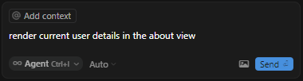
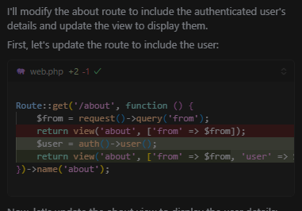
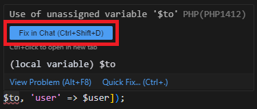

# Vibe Coding getting smarter with PHP diagnostics

[PHP Tools for VS Code](https://marketplace.visualstudio.com/items?itemName=DEVSENSE.phptools-vscode) works seamlessly with [Cursor](https://www.cursor.com/)—the popular AI-powered code editor. With the PHP Tools extension, you get a full suite of features, including code completion, intelligent code actions, an integrated debugger, advanced syntax highlighting, and effortless navigation. But that’s not all! It also offers workspace-wide code analysis and detailed diagnostics. Plus, these features are fully compatible with the AI chat agent, creating a powerful coding experience.

<!-- more -->

## Vibe Coding: The Future of Development



One of the biggest trends in coding today is **vibe coding**. This approach allows developers—and even non-developers—to ask AI for coding suggestions, modifications, and improvements. From our perspective, it feels like magic! With *vibe coding*, even those with little to no programming experience can create fully functional applications by simply interacting with AI.



## The Catch: AI Still Makes Mistakes

Despite its power, AI is not infallible. It occasionally introduces subtle mistakes—issues that may not be immediately obvious but can cause code to break. Fortunately, this is where [PHP Tools](https://marketplace.visualstudio.com/items?itemName=DEVSENSE.phptools-vscode) shines. By continuously analyzing the code, the extension identifies errors and provides clear diagnostics. This means the AI chat agent can automatically detect and fix these issues, creating a beautifully symbiotic workflow.

## From Problem to Solution

The [PHP Extension](https://marketplace.visualstudio.com/items?itemName=DEVSENSE.phptools-vscode) continuously monitors your code, leveraging a wide range of heuristics and rules. With full awareness of your workspace and project dependencies, it usually can:

- Detect undefined symbols
- Highlight type mismatches
- Identify syntax errors based on your PHP version
- Warn about deprecated functions
- Point out potential problems and suggest refactorings
- And much more!



Each issue comes with a human-readable description, which is invaluable for the AI chat agent. By feeding this information directly into its prompts, AI can generate more accurate fixes, significantly improving the development experience.

## Example: AI Writes Code, PHP Tools Keeps It Honest

Imagine you ask your AI agent to add a new endpoint to a Laravel controller. The AI might write something like this:

```php
public function store(Request $request)
{
    $order = new Order();
    $order->customer_name = $request->input('customer');
    $order->save();

    return response()->json($order, 201);
}
```

PHP Tools will immediately flag several potential problems in this code:

- `customer_name` may not be a fillable property on the `Order` model (mass-assignment protection).
- `$request->input('customer')` returns `null` when the field is missing, which may violate a database `NOT NULL` constraint.
- The `Order` class may not be imported with a `use` statement, producing an "unknown class" diagnostic.

Because each diagnostic carries a human-readable message and an error code, your AI agent can read the Problems panel, understand what is wrong, and propose a fix—such as adding `$fillable` to the model, validating the request, or importing the class—without you having to hunt down each issue by hand.

## Give AI Deeper Context with MCP

PHP Tools also exposes an **MCP (Model Context Protocol) server** that lets AI agents query semantic information about your codebase directly. Instead of guessing from file contents, the agent can ask PHP Tools for:

- PHP symbols and their locations
- Types and type relationships
- Class inheritance and implementations
- References and usages
- Call hierarchies

For example, before renaming a service, an AI agent can use the MCP server to list every caller of a method and confirm the change is safe. This is especially valuable in large applications where understanding relationships between files matters more than understanding any single file.

For setup instructions, see the [MCP Server documentation](https://docs.devsense.com/vscode/ai/mcp/).

## Explore Call Hierarchy Before Refactoring

When an AI agent suggests renaming or removing a method, it helps to know who calls it first. PHP Tools provides **Call Hierarchy** so you can explore incoming and outgoing calls directly from the editor.

This is particularly useful before making potentially risky changes to controllers, services, or repositories. See the [Call Hierarchy documentation](https://docs.devsense.com/vscode/tools/call-hierarchy/) for details.

## With PHP Tools and AI Working Together

Debugging and refining your code has never been easier. PHP Tools continuously validates the code your AI agent writes, surfaces clear diagnostics, and exposes semantic context through MCP. The result is a faster, safer vibe-coding workflow where AI proposes changes and PHP Tools keeps them honest.

With PHP Tools and AI working together, debugging and refining your code has never been easier.

## Related Links

- [PHP Tools for VS Code](https://marketplace.visualstudio.com/items?itemName=DEVSENSE.phptools-vscode)
- [MCP Server documentation](https://docs.devsense.com/vscode/ai/mcp/)
- [Call Hierarchy documentation](https://docs.devsense.com/vscode/tools/call-hierarchy/)
- [Code Actions documentation](https://docs.devsense.com/vscode/code%20actions/)
