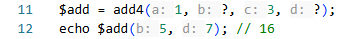
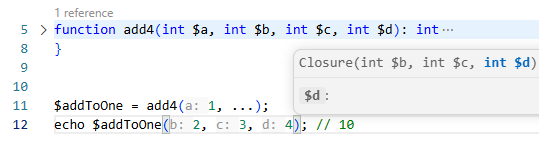
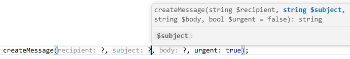
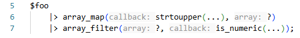
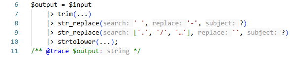

# PHP 8.6 Partial Function Application: Smarter Callbacks with PHP Tools

PHP 8.6 introduces **Partial Function Application (PFA)**, a new language feature that makes working with callbacks simpler and more expressive. Instead of writing small arrow functions just to fix a few arguments, you can now create reusable closures directly from function calls.

PHP Tools brings intelligent development support for this new syntax across **Visual Studio Code, Visual Studio, and other editors powered by the [`devsense-php-ls` language server](https://docs.devsense.com/other/lsp/)**. With type inference, inlay hints, and signature help, you can take advantage of PFA while keeping your code readable and easy to maintain.

## What is Partial Function Application?

Have you ever written an arrow function just to pass a value through another function, reorder a couple of arguments, or configure a callback?

Consider this example:

```php
$strings = ['hello world', 'hello there'];

$result = array_map(
    static fn(string $s): string => str_replace('hello', 'hi', $s),
    $strings,
);
```

The callback is straightforward, but the arrow function introduces an extra layer of syntax. You have to declare a parameter, specify its type if desired, and forward it to the original function.

With PHP 8.6, Partial Function Application lets you express the same operation more directly:

```php
$strings = ['hello world', 'hello there'];

$result = array_map(
    str_replace('hello', 'hi', ?),
    $strings,
);
```

The `?` placeholder marks an argument that will be supplied later. Instead of executing the function immediately, PHP creates a closure that accepts the missing argument and passes it to `str_replace()`.

The result is shorter, more expressive code that communicates your intention directly: replace `hello` with `hi` for each string.

## How PFA works

Partial Function Application supports two placeholders:

- `?` reserves a single argument to be supplied later.
- `...` forwards the remaining arguments to the function when the resulting closure is invoked.

For example, you can preconfigure a function while leaving one or more arguments open:

```php
function add4(int $a, int $b, int $c, int $d): int
{
    return $a + $b + $c + $d;
}

$add = add4(1, ?, 3, ?);

echo $add(5, 7); // 16
```



The resulting closure accepts the two missing arguments, while the other values are already fixed.

You can also use `...` to leave the remaining arguments open:

```php
$addToOne = add4(1, ...);

echo $addToOne(2, 3, 4); // 10
```

_The editor shows the named parameters inlined:_


In both cases, PHP determines the resulting closure's parameter list from the original function signature and the supplied arguments.

This is where intelligent editor support becomes especially useful. As the syntax becomes more concise, understanding the resulting callable's parameters and types directly in the editor becomes increasingly important.



## PHP Tools: Intelligent support for PFA

PHP Tools understands PHP code beyond its syntax. Its language analysis provides type information and contextual assistance to help you navigate complex expressions, callbacks, and function signatures.

With PFA support, developers can work with partially applied functions while benefiting from the same intelligent editing experience available throughout PHP Tools.

### Type inference for partially applied functions

A partially applied function is a closure with a signature derived from the original function. Correctly inferring that signature is important for everything that follows: completion, diagnostics, navigation, and understanding how values flow through the code.

Consider:

```php
function formatPrice(float $price, string $currency): string
{
    return $currency . ' ' . number_format($price, 2);
}

$formatUsd = formatPrice(?, 'USD');

$result = $formatUsd(19.99);
```

The `$formatUsd` variable represents a callable that accepts a `float` and returns a `string`. The `currency` argument has already been supplied.

PHP Tools analyzes the partially applied function and infers the resulting callable's type, helping you understand how it can be used elsewhere in your application.


### Inlay hints reveal inferred parameter types

When a function's arguments are partially applied, the remaining parameters can be less obvious than they are in a conventional function declaration.

PHP Tools inlay hints help make inferred types visible directly in the editor, without requiring you to jump to the original function or manually expand the closure.

For example:

```php
$formatUsd = formatPrice(?, 'USD');
$result = $formatUsd(19.99);
```

Inlay hints can help clarify the types involved when working with the resulting callable and its arguments. This is particularly valuable when PFA expressions appear inside larger chains of transformations or when working with generic collection helpers and framework APIs.

### Signature help when working with placeholders

PFA does not eliminate the original function's signature. Instead, it changes which arguments must be supplied now and which remain available for the eventual closure invocation.

Consider a function with several parameters:

```php
function createMessage(
    string $recipient,
    string $subject,
    string $body,
    bool $urgent = false,
): string {
    // ...
}

$sendUrgent = createMessage(?, ?, ?, urgent: true);
```

While editing this expression, you still need to know the original function's parameter names, types, and optional arguments to apply the placeholders correctly.

PHP Tools signature help provides contextual information about function parameters as you write code, making it easier to construct valid PFA expressions and understand the arguments being configured.



## PFA and the PHP 8.5 pipe operator

One of the most compelling uses of Partial Function Application is its combination with the pipe operator introduced in PHP 8.5.

The pipe operator passes the result of one expression to the next callable. However, many useful PHP functions accept more than one argument, and the value flowing through the pipeline is not always the first argument.

PFA makes these functions much easier to use.

```php
$foo
    |> array_map(strtoupper(...), ?)
    |> array_filter(?, is_numeric(...));
```

_The editor shows the code with inlay hints:_



The placeholders indicate where the value from the previous step should be passed. There is no need to introduce an arrow function simply to adapt the function's signature.

This combination makes transformation pipelines easier to read from beginning to end and reduces the amount of code required to connect existing functions.



PHP Tools helps you work with these expressions using contextual language intelligence, inferred types, and parameter information.

## A natural fit for everyday PHP development

PFA is useful well beyond functional programming examples. It can simplify everyday development tasks involving reusable callbacks, configured functions, and deferred execution.

For example, you can create a reusable callback with predefined arguments:

```php
$containsPhp = str_contains(?, 'PHP');

var_dump($containsPhp('I love PHP')); // true
var_dump($containsPhp('I love Rust')); // false
```

Or configure a function that can be invoked later:

```php
function calculateTotal(
    float $price,
    float $tax,
): float {
    return $price * (1 + $tax);
}

$calculateWithVat = calculateTotal(?, 0.21);

$total = $calculateWithVat(100.00);
```

These examples illustrate the main benefit of PFA: separating configuration from execution without introducing a separate wrapper function.

As with any new language feature, choosing the right abstraction still matters. A named closure can remain the better option when it communicates business intent more clearly than a compact expression.

## Available across PHP Tools editors

PHP Tools provides PHP language intelligence in multiple development environments, powered by its language analysis technology.

- [**PHP Tools for Visual Studio Code**](https://docs.devsense.com/vscode/) - intelligent editing and PHP language support directly in VS Code.
- [**PHP Tools for Visual Studio**](https://docs.devsense.com/vs/) - PHP development integrated into the Visual Studio IDE.
- [**`devsense-php-ls`**](https://docs.devsense.com/other/lsp/) - the standalone PHP language server for other editors and tools that support the Language Server Protocol (LSP).
- [**PHP in Zed Editor**](https://docs.devsense.com/other/zed/) - with the support for "phptools", the editor will understand the new syntax, including diagnostics, hints, and code actions.

This shared language-server architecture helps deliver consistent PHP language intelligence across supported environments, so developers can benefit from the same core analysis regardless of their preferred editor.

## Start using PHP 8.6 with PHP Tools

Partial Function Application is a small syntax addition with practical benefits. It removes repetitive callback wrappers, makes configured functions easier to express, and works particularly well with PHP's pipe operator.

With PHP Tools, you can combine this more concise syntax with intelligent type inference, inlay hints, and signature help to understand your code as you write it.

Whether you work in Visual Studio Code, Visual Studio, or another LSP-compatible editor, PHP Tools helps make modern PHP development more productive.

**Explore PHP Tools and experience a smarter PHP development workflow.**