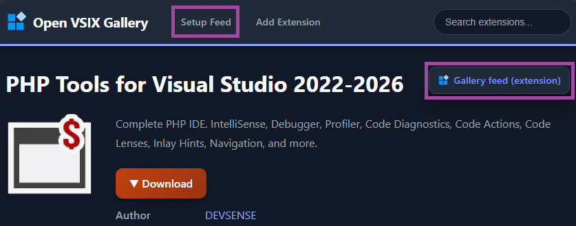
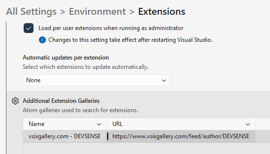
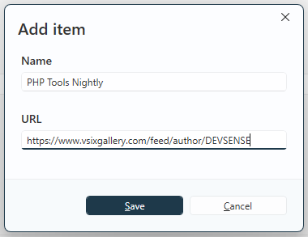

# Nightly Builds of PHP Tools for Microsoft Visual Studio

We're making it easier to try the latest PHP Tools improvements before they arrive in a stable release. **PHP Tools for Visual Studio is now available on Open VSIX Gallery**, with a feed that provides the latest nightly and release build.

<!-- more -->

By connecting Visual Studio to this feed, you can keep your installation up to date with the latest development builds and try new improvements as soon as they're available — without manually downloading and installing every update.

[**Explore PHP Tools on Open VSIX Gallery →**](https://www.vsixgallery.com/extension/97D92289-92CB-6666-AA3E-B9506D2C1740)

## What is Open VSIX Gallery?

Open VSIX Gallery is an online gallery for Visual Studio extensions. It provides an alternative way to discover and distribute VSIX packages, including development builds that you may want to try before their official stable release.

For PHP Tools, we're using the gallery to publish a continuously updated nightly build feed. The feed points to the latest available development version, making it easier to follow the progress of PHP Tools between stable releases.

## Why use nightly builds?

Stable releases are the recommended choice for everyday production work. But if you'd like to explore what's coming next, nightly builds give you an earlier look at ongoing development.

- **Get improvements sooner.** Try new features, IntelliSense enhancements, and fixes before the next stable release.
- **Stay up to date automatically.** Configure the feed once and let Visual Studio check for available updates.
- **Follow development as it happens.** Test recent changes without repeatedly visiting the website to look for a new package.
- **Help us improve PHP Tools.** Early feedback can help us identify problems and refine features before they reach a stable release.

Nightly builds are development versions, so they may contain regressions or unfinished changes. If stability is your priority, we recommend sticking with the regular stable release.

## How to add the PHP Tools feed to Visual Studio

You can configure Visual Studio to use the Open VSIX Gallery feed as an additional source for extension updates.

### 1. Open the PHP Tools page

Visit the PHP Tools listing on Open VSIX Gallery:

[https://www.vsixgallery.com/extension/97D92289-92CB-6666-AA3E-B9506D2C1740](https://www.vsixgallery.com/extension/97D92289-92CB-6666-AA3E-B9506D2C1740)

Find the feed setup instructions on the page.

### 2. Add the feed to Visual Studio

Open Visual Studio and navigate to **Tools → Options → Environment → Extensions**.

Locate the settings for extension sources. Add a new source using the feed URL provided by Open VSIX Gallery, and give it any name:

- **Name**: `PHP Tools Nightly` (or anything else)
- **URL**: `https://www.vsixgallery.com/feed/author/DEVSENSE`

### 3. Check for updates

Open **Extensions → Manage Extensions** and check for available updates to PHP Tools. Once the gallery feed is configured, Visual Studio can use it to discover newer builds.

### 4. Stay up to date

Keep the feed configured to continue receiving the latest nightly builds as they become available. You no longer need to manually download each new build.

The exact update behavior depends on Visual Studio's extension management settings, so check for updates if a newer build doesn't appear immediately.

## Ready to try it?

Visit the [PHP Tools page on Open VSIX Gallery](https://www.vsixgallery.com/extension/97D92289-92CB-6666-AA3E-B9506D2C1740) and follow the feed setup instructions to get started.

Whether you're interested in testing a recent fix, exploring an upcoming feature, or helping us improve PHP Tools, nightly builds offer a convenient way to stay close to development.

**Happy coding!**

*The PHP Tools Team — DEVSENSE*