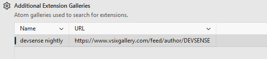
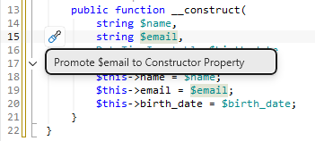
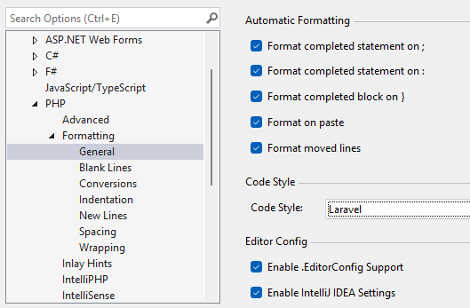

/*
Title: October 2026 (1.91)
Tags: release notes,visual studio,IntelliSense,starred suggestions,vsixgallery
Date: 2026-10-15
*/

# October 2026 (version 1.91)

We're happy to announce **PHP Tools 1.91 for Visual Studio 2022 and Visual Studio 2026**, with an update also available for **Visual Studio 2019**. This release brings improvements across code intelligence, diagnostics, refactoring, Laravel development, and PHP formatting.

This release focuses on making everyday PHP development more productive, with more accurate type inference, clearer diagnostics, and useful new code actions.

## Try the Latest Nightly Builds via Open VSIX Gallery

Want to try the latest PHP Tools improvements before the next stable release? **PHP Tools for Visual Studio 2022–2026 is now available on Open VSIX Gallery**, providing a dedicated feed with the latest nightly builds.

The feed is continuously updated with the newest available build, so you can configure Visual Studio to check for updates and automatically stay up to date without manually downloading and installing each new version.

This is a convenient way to get early access to ongoing improvements, try new features as they arrive, and help us identify issues before they reach a stable release.

**Get started:**

- **Browse the feed:** [PHP Tools on Open VSIX Gallery](https://www.vsixgallery.com/extension/97D92289-92CB-6666-AA3E-B9506D2C1740)
- **Connect to Visual Studio:** Open **Tools > Options > Environment > Extensions**, then add the gallery as shown below.

*Please note that nightly builds are pre-release versions and may contain unfinished features or unexpected issues.*

## New Refactorings and Code Actions

PHP Tools 1.91 introduces useful improvements to everyday refactoring workflows.

- **Promote properties to constructor parameters** — new code actions help turn existing properties and assignments into constructor property promotion, while preserving existing attributes.
- **Improved Rename refactoring** — better handling of names enclosed in quotes and references inside grouped `use` statements.
- **Navigate from string literals** — jump to classes and methods referenced by string values, making it easier to explore code that uses string-based references.
- **Better callable-string support** — improved analysis and refactoring support for methods referenced through callable strings.

These enhancements make it easier to navigate existing code and apply common transformations without manually editing multiple locations.

## Improved Laravel Support

This release brings several improvements for Laravel applications, with a focus on dependency resolution, Eloquent models, and framework conventions.

- **Better service resolution** — improved completion and type inference for `resolve()` and `App::makeWith()`.
- **Improved request handling** — more accurate type resolution for `Request::user()`.
- **Better Eloquent type inference** — improved support for relationship properties, generic relationship types, and factory conventions.
- **Improved view support** — better recognition of Laravel view types and their associated methods.
- **More reliable model properties** — improved resolution of relation properties, including case-insensitive matching.

Together, these changes help IntelliSense better understand Laravel's conventions and provide more useful suggestions when working with application services, models, and views.

## PHP Formatter Improvements

The built-in PHP formatter receives several refinements, especially for PHP attributes and multiline code.

- **Improved attribute formatting** — better support for wrapping attributes according to PSR-12 style conventions.
- **More consistent blank lines** — improved formatting around functions, methods, classes, and declarations that use attributes.
- **Better indentation** — fixes for arrow functions and `match` expressions.
- **Safer formatting of multiline code** — improved handling of formatting boundaries and related edge cases.

These changes help keep your code consistently formatted while working with modern PHP syntax.

## Smarter IntelliSense and Type Inference

PHP Tools continues to improve its understanding of your code, helping you get more accurate completions and type information in complex scenarios.

- **Better generic type inference** — improved handling of generic types, including types passed by reference, traits, and conditional expressions.
- **More accurate type narrowing** — improved type resolution across conditional branches, `instanceof` checks, `is_object()`, and other common patterns.
- **Improved completion in complex expressions** — IntelliSense handles additional expression patterns and provides better suggestions for properties and generic classes.
- **Better PHPDoc and Psalm support** — improved handling of annotations, including `@psalm-this-out`, `@psalm-if-this-is`, and Psalm assertions.

These refinements help PHP Tools better understand the intent of your code and provide more reliable assistance while you work.

## More Precise Diagnostics

We've improved code analysis to make diagnostics more accurate and easier to understand.

- **Unreachable code detection** — diagnostics now highlight entire unreachable blocks, including affected branches in `if` and `switch` statements.
- **Improved type and exception checks** — fewer misleading reports in scenarios involving undefined base classes, generic types, and nullability.
- **Clearer diagnostics for anonymous functions** — diagnostic messages now identify anonymous functions more consistently.
- **Better override error messages** — errors involving missing overrides provide more useful explanations.

## PHPUnit and Testing Improvements

We've improved PHPUnit integration and test discovery.

- **Better data provider completion** — PHPUnit's `#[DataProvider]` attribute now offers data provider suggestions, with clearer information in completion tooltips.
- **Improved test discovery** — tests without namespaces are handled more reliably in Test Explorer.

## Editor and Workflow Improvements

Several additional refinements make everyday development smoother.

- **Smarter generated PHPDoc** — generated `@return` annotations better preserve an explicitly specified type hint.
- **Improved HEREDOC and NOWDOC editing** — smart indentation better preserves indentation inside multiline string literals.
- **Better Composer integration** — updated Packagist API handling improves compatibility when retrieving package information.
- **Improved performance** — optimizations reduce allocations in frequently used code paths, including completion-related license checks and PHPDoc processing.

## Fixes and Stability Improvements

This release includes a number of important fixes to improve the stability and reliability of PHP Tools across everyday development workflows.

- **Improved runtime stability** — fixed an issue that could cause a .NET runtime crash when processing certain values.
- **More reliable IntelliSense** — fixed several issues that could lead to unexpected errors during code completion.
- **Improved parser robustness** — fixed parsing issues involving HEREDOC and NOWDOC strings, with better recovery when encountering invalid or incomplete PHP code.
- **More reliable code analysis** — addressed issues in type inference, control-flow analysis, and diagnostics to prevent incorrect results in complex code scenarios.
- **Improved Composer integration** — fixed package information retrieval issues caused by Packagist API access restrictions.
- **General reliability improvements** — resolved additional exceptions and stability issues across internal components and editor workflows.

These fixes make PHP Tools more robust, helping you work with complex PHP projects with greater confidence.

---

## Update to PHP Tools 1.91

PHP Tools 1.91 is available for **Visual Studio 2022 and Visual Studio 2026**. Most of the improvements are also available for **Visual Studio 2019**.

Update to the latest version and enjoy a more accurate, productive PHP development experience.

**Happy coding!**
