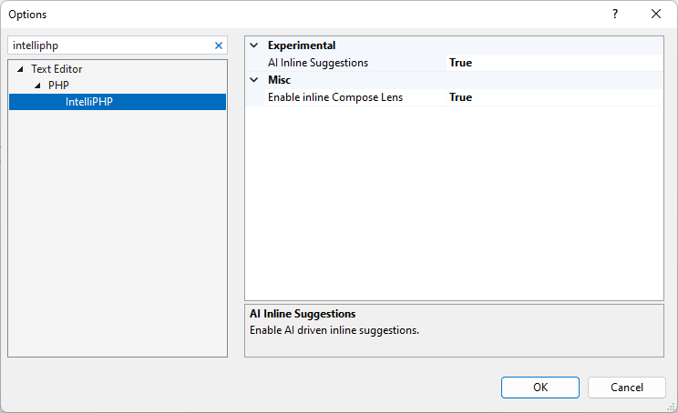

/*
Title: IntelliPHP
Description: AI Autocomplete for PHP
*/

# IntelliPHP - AI Autocomplete for PHP

IntelliPHP is an AI-assisted autocomplete feature for PHP developers, included in PHP Tools for Visual Studio. It provides context-aware code suggestions as you type, ranging from short completions to whole lines of code. Unlike cloud-based assistants, IntelliPHP runs entirely on your local machine, so no code is sent to an external server.

The model has been trained in-house on PHP code repositories, making it well suited to PHP development. It helps you write code faster by suggesting likely completions while you type.

## Installation and Setup

IntelliPHP is included with PHP Tools for Visual Studio. To get started, make sure you have Visual Studio 2022 or newer installed and the PHP Tools extension installed from [Visual Studio](https://www.devsense.com/download) or from `Tools | Extensions` in Visual Studio.

IntelliPHP is enabled by default starting from version `1.74`. You can turn it on or off in `Tools | Options | Text Editor | PHP | IntelliPHP`.

## Installation and Setup

IntelliPHP seamlessly integrates with Visual Studio 2022+, enhancing your PHP development experience. To get started, follow these simple steps:

1. **Prerequisites:** Ensure you have Visual Studio 2022 or newer installed on your system.

2. **Download and Install IntelliPHP:** IntelliPHP is part of PHP Tools for Visual Studio extension which you can download [HERE](https://www.devsense.com/download) or directly from Visual Studio in `Tools | Extensions` menu.

3. **Configuration:** IntelliPHP is enabled by default starting from version `1.74`. If needed, you turn it on or off when you go to `Tools | Options | Text Editor | PHP | IntelliPHP`.

## Features

IntelliPHP is designed to save you time and boost your productivity. Here are some of its key features:

- **AI Auto-completion:** Enjoy context-aware auto-completion suggestions as you type your PHP code.
- **Code Snippets:** IntelliPHP provides code snippets and whole lines of code to streamline your development process.
- **Framework Support:** Whether you're using Laravel, Symfony, or any other PHP frameworks, IntelliPHP has you covered.
- **Local:** IntelliPHP operates locally, no code leaves your machine EVER.
- **Speed:** IntelliPHP was designed to run efficiently on CPU, no GPU is required! The suggestions are returned without any latency penalty caused by the network.

## Accepting suggestions

When IntelliPHP offers a suggestion, you can effortlessly incorporate it into your code:

**Accepting Suggestions:** Simply press <kbd>TAB</kbd> to accept a suggestion. If you've already partially typed a suggestion, the first <kbd>TAB</kbd> will complete the first part, and a second <kbd>TAB</kbd> will finish the rest.

**Continuous Typing:** If a suggestion isn't what you need, continue typing, and the suggestion will disappear. A new one might appear if it's a better fit for your code.

## Troubleshooting

Encountering issues? Please let us know at [community.devsense.com](https://community.devsense.com)
