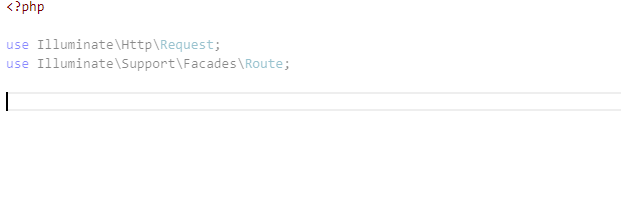

/*
Title: IntelliPHP
Description: Local AI Autocomplete for PHP
*/

# IntelliPHP - AI Autocomplete for PHP

IntelliPHP is an AI-assisted autocomplete feature for PHP programmers. Unlike cloud-based assistants such as GitHub Copilot, IntelliPHP runs entirely on your local machine, so no code leaves your development environment.

IntelliPHP was trained specifically on PHP code to provide context-aware suggestions, ranging from short completions to whole lines of code. Its primary aim is to save time spent typing code.

> ℹ️ **Looking for Starred Suggestions (AI Ranking)?**  
> Smart re-ranking of the IntelliSense completion list with star icons (★) is not part of the IntelliPHP extension. It is integrated directly into the main [PHP Tools for VS Code](./starred-suggestions.md) extension as a Premium feature.

## Settings

| Setting | Description |
| ---     | ---         |
| `intelliphp.inlineSuggestionsEnabled` | Enables or disables inline suggestions in PHP files. |

## Disable or Uninstall

If you do not want the inline suggestion assistant, or you need to save system resources, you can disable or uninstall the IntelliPHP extension.

Use the VS Code **Extensions** panel, navigate to the `DEVSENSE.intelli-php-vscode` extension, and manage it there.

## Features

IntelliPHP is designed to save you time and boost your productivity. Here are some of its key features:

- **AI Auto-completion:** Enjoy context-aware auto-completion suggestions as you type your PHP code.
- **Code Snippets:** IntelliPHP provides code snippets and whole lines of code to streamline your development process.
- **Framework Support:** Whether you're using Laravel, Drupal, WordPress, or any other PHP frameworks, IntelliPHP has you covered.
- **Local:** IntelliPHP operates locally, no code leaves your machine EVER.
- **Speed:** IntelliPHP runs efficiently on CPU — no GPU required — so suggestions return without the latency of a network round-trip.

## Accepting suggestions

When IntelliPHP offers a suggestion, you can effortlessly incorporate it into your code:

**Accepting Suggestions:** Simply press <kbd>TAB</kbd> to accept a suggestion. If you've already partially typed a suggestion, the first <kbd>TAB</kbd> will complete the first part, and a second <kbd>TAB</kbd> will finish the rest.

You can also accept just a current word in the offered suggestion by pressing <kbd>Ctrl</kbd> + <kbd>Right Arrow</kbd>.

**Snippets:** IntelliPHP intelligently identifies parts of the suggestion that require developer input and places the cursor there. You can then easily fill in the necessary details. Pressing <kbd>TAB</kbd> will navigate to the next input location within the suggestion, helping you efficiently complete the snippet. If there are no more input locations, pressing <kbd>TAB</kbd> will take you to the end of the suggestion, allowing you to continue your coding seamlessly.

**Continuous Typing:** If a suggestion isn't what you need, continue typing, and the suggestion will disappear. A new one might appear if it's a better fit for your code.

## Troubleshooting

- Check the log output in the VS Code **OUTPUT** window, tab **IntelliPHP**.
- Make sure the setting `editor.inlineSuggest.enabled` is `true`.
- Check the license state in **IntelliPHP: About**. Run the **`IntelliPHP: About ...`** command to open the about page.
