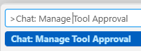
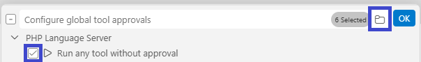

/*
Title: MCP Server
Description: Model Context Protocol Support
*/

# MCP Server

> Requires PHP Tools version 1.74 or later.

> Available in VS Code-based editors that support the
> `contributes.mcpServerDefinitionProviders` extension point, including VS Code,
> Cursor, Windsurf, and Trae.

The PHP extension includes a Model Context Protocol (MCP) server. It exposes
tools, skills, and context that compatible AI agents can use to access
workspace-aware information from PHP Tools.

## MCP Tools

MCP tools give compatible AI agents access to semantic information about your
open workspace. This can help them answer PHP-related questions with more
relevant context and reduce the need to search through files manually.

## Call Tools without confirmation

Open _Command Palette_ (`F1`), and search for `Chat: Manage Tool Approval`:

- **Untick** the "Folder" button, so it applies for all your workpaces.
- **Tick** _Run any tool without approval_; so agents can run the tool to get extended information and tools for your projects without you confirming every action.

