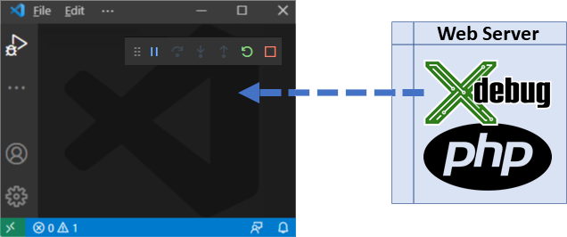
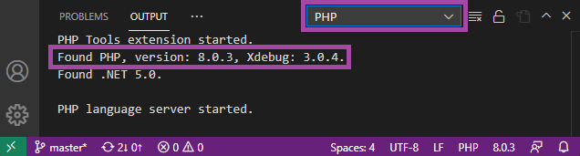
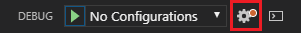
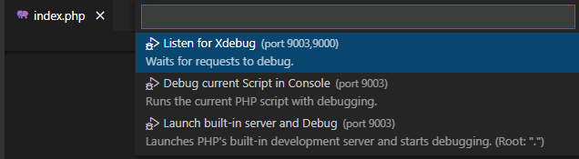
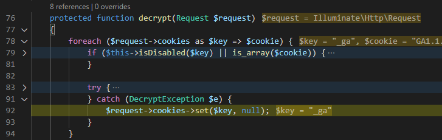

/*
Title: Debug Overview
Description: 
*/

# Debug Overview



Debugging of PHP code in VS Code allows for inspecting a PHP program, inspecting actual variables, stack traces, exceptions, breaking and stepping through the code, debugging PHPUnit tests, and more.

## Requirements

To debug a PHP program, you need PHP (installed locally or on your server) together with the [Xdebug](https://xdebug.org) extension.

- PHP >= 5.6
- Xdebug extension. Follow the steps on [Xdebug.org Install](https://xdebug.org/docs/install).

### Local PHP Installation

If there are multiple PHP installations on the system, see [Choosing PHP Version](../php-version.md) and select the right one.

To verify PHP and Xdebug are installed correctly:

1. Open a `.php` file in VS Code.
2. Open the **OUTPUT** view, tab **PHP**.



If PHP with Xdebug is installed correctly, you will see:

```
Found PHP, version x.y.z, Xdebug: x.y.z.
```

### `php.ini` Configuration

Xdebug must be configured in the `php.ini` file that corresponds to your PHP installation.

- **On Windows** it is located next to your `php.exe`.
- **On Linux/Mac** there is usually a separate `xdebug.ini` file (for example `/etc/php/8.0/cli/xdebug.ini`).

Edit the `.ini` file and ensure the following directives are present (note that the directives differ between Xdebug versions `2` and `3`):

```ini
; Xdebug 3
zend_extension = "<path to the xdebug library>" ; "...\xdebug.dll" or ".../xdebug.so"
xdebug.mode = debug
xdebug.client_host = 127.0.0.1
xdebug.client_port = 9003
xdebug.start_with_request = trigger
```

```ini
; Xdebug 2
zend_extension = "<path to the xdebug library>" ; "...\xdebug.dll" or ".../xdebug.so"
xdebug.remote_enable = 1
xdebug.remote_handler = dbgp
xdebug.remote_host = 127.0.0.1
xdebug.remote_port = 9000
xdebug.remote_mode = req
```

### Server PHP Installation

This applies when PHP is not running on your local system but on a **cloud**, **web host**, **Docker**, or **Xampp**, etc.

If `php` itself is not running on your local system, consult the PHP+Xdebug installation for the specific server host.

You can then take advantage of [DBGP Proxy](dbgp-proxy.md) to allow multiple users to debug the same site safely.

## Launching Debug in VS Code

Launch debugging in Visual Studio Code to either run the program and debug, or to listen for incoming Xdebug connections and debug. PHP debugging can be initiated in several ways, with or without VS Code Workspace, with or without the configured `launch.json`.

### With `launch.json`

> The file `.vscode/launch.json` is a configuration file within your VS Code Folder or Workspace.

1. **Open Folder** or **Open Workspace** in VS Code. This allows you to specify more detailed debug launch configurations.
2. Navigate to **Run and Debug** and click **create a launch.json** or the configuration gear:


3. See [launch.json](launch-json.md) for the initialization and description of the PHP launch profiles.

### No `launch.json`, Just Debug

Debugging can be started without any configuration. This is recommended if you just need to attach to an existing web server (with Xdebug configured) or to quickly run and debug a PHP script.

1. Open a `.php` file in VS Code (`File` > **Open File**).
2. Press **`F5`** or open the **Command Palette** (`F1`) and choose one of the following:



- **`Listen for Xdebug`** starts debugging and waits for an incoming Xdebug connection.
- **`Launch current script in console`** runs and debugs the currently opened PHP document as a console PHP program.
- **`Launch built-in server`** starts the PHP development server within your opened folder, checks debugging capabilities, and starts listening for Xdebug connections.

## Features

The debugging features are the following:

- Stepping by line, step in, step out.
- Placing breakpoints, conditional breakpoints, break on hit count.
- Logging breakpoint hit into 'Debug console'.
- Breaking on exceptions, warnings, and errors.
- Specifying non-user files (exceptions won't break debugging, stepping through).
- Watch tool tips.
- Listing locals and superglobals.
- Editing variable or property value, handling long string values efficiently.
- Long arrays watch efficiently.
- Debug watch expands objects and arrays.
- Evaluating code in 'Debug console'.
- Debug launch profiles.
- Built-in web development server.
- Debugging of 'PHP Unit' test cases.

### Debug Adornments

When stepping through the code, the editor will display values of variables and expressions corresponding to the current statement. Values are also shown for the enclosing scopes such as loop control variables, switch expression, and function parameters.

This feature can be enabled or disabled using the VS Code setting `"debug.inlineValues"`.



### Start Debug and Stop on Entry

Open **command palette** and run `Start Debugging and Stop on Entry` (aka *Step Into*). The command launches debugging and breaks on the first statement. 

## Troubleshooting

These steps help diagnose and solve common problems when debugging PHP:

- Running the following command should display no warnings and an Xdebug notice:

  ```bash
  php --version
  ```

- The port number specified in the Xdebug `.ini` configuration should be `9000` or `9003`, or it should match the `"port"` specified in the [Launch Profiles](launch-json.md).
- The firewall must be configured to allow communication through the Xdebug port.
- Append the following query parameter when opening the debugged PHP website:

  ```
  ?XDEBUG_SESSION_START=1
  ```

  For example: `http://localhost/?XDEBUG_SESSION_START=1`
- If VS Code is behind a proxy, see [VS Code Network Settings (Proxy)](https://code.visualstudio.com/docs/setup/network) for additional settings.

## See Also

- [Xdebug.org](https://xdebug.org/)
- [Installing Xdebug on Mac](https://blog.devsense.com/2019/how-to-install-xdebug-for-phptools-for-vscode-on-mac)
- [Launch Configurations](launch-json.md)
- [VS Code Network Settings (Proxy)](https://code.visualstudio.com/docs/setup/network)