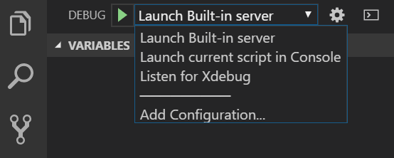

/*
Title: Launch Profiles
Description: Configuration of the debugger
*/

# Launch Profiles

Launch profiles define the way Visual Studio Code runs and debugs the project.

## `launch.json`

Visual Studio Code stores launch configurations in a `launch.json` file located in the `.vscode` subfolder of a workspace (the project root folder). To select, add, or modify configurations, open the **Run and Debug** side panel.



### Listen for Xdebug (Local or Remote Debug)

The following profile initiates debugging of an already running PHP application. The debugger waits for an Xdebug connection on a specified port. PHP Tools does not start any web server. This is the most common debugging scenario and requires that you correctly set up `php` with the `xdebug` extension.

```json
{
    "name": "Listen for Xdebug",
    "type": "php",
    "request": "launch",
    "port": 9003,

    "pathMappings": {
        "\\remotepc\Shared\Test\": "${workspaceRoot}\src",
        "\\test": "C:\Users\usr\Documents\VSCode\src"
    }
}
```

Press **`F5`** or **Run and Debug** to start listening for Xdebug connections.

- **`port`** is the incoming Xdebug port number. It can be a single number (for example `9003`), an array of numbers (for example `[9003, 9000]`), or it can be omitted so the debugger uses the port specified in the `"php.debug.port"` setting.
- **`pathMappings`** is used for remote debugging. This setting maps server paths to local paths so the debugger matches breakpoints on the local machine with the server paths.
- **`hostname`** specifies whether to listen on IPv4 (`0.0.0.0`) or IPv6 (`::`). By default, the debugger listens on IPv4 (`0.0.0.0`) and tries to listen on IPv6 (`::`) as well. On Linux systems, listening on both networks might not be allowed, so `hostname` should be specified explicitly.

### Listen on IPv6 on Linux

On Windows, the debugger listens on both IPv4 and IPv6 at the same time. On Linux, the protocol should be specified explicitly. The following launch profile listens on IPv6 with the default ports (`9003`, `9000`):

```json
{
    "name": "Listen on Xdebug (IPv6)",
    "type": "php",
    "request": "launch",
    "hostname": "::"
}
```

If `hostname` is not specified, the debugger listens on IPv4 by default.

### DBGp Proxy settings

The multi-user debugging scenario is described in detail in the [tutorial for Visual Studio](https://docs.devsense.com/vs/debugging/multi-user). In VS Code, the configuration is placed directly into `launch.json`.

The launch configuration for **Listen for Xdebug** together with `dbgpProxy` is listed below:

```json
{
    /* listening for Xdebug connection: */
    "name": "Listen for Xdebug",
    "type": "php",
    "request": "launch",
    "port": 9003,

    /* DBGp Proxy configuration: */
    "dbgpProxy":
    {
        "enable": true,
        "host": "127.0.0.1",
        "port": 9002,
        "ideKey": "MyVSCode"
    }
}
```

- **`enable`** turns the connection to the DBGp Proxy server on or off.
- **`host`** and **`port`** specify the address of the DBGp Proxy server.
- **`ideKey`** is used to register the debug session within the DBGp Proxy. If not set, the current user name is used instead.

Upon running the project (`F5` or `Run and Debug` command), the following text gets logged in the Debug Console:

```
Registering with the DBGp proxy on 127.0.0.1:9002 with key Arnold...
Registration was successful!
```

**DBGp Proxy IDE key**

If not specified, the DBGp Proxy IDE key is set automatically to the current user name. It is also logged in VS Code's Output window. When accessing the web, this IDE key must be used in the URL (for example `http://example.org?XDEBUG_SESSION_START=MyVSCode`), the `xdebug.idekey` php.ini directive, or the `DBGP_IDEKEY` environment variable (see [xdebug.org](https://xdebug.org/docs/step_debug#idekey) for more details). This lets the proxy server know which machine to connect back to with the debug session.

### Ignored Paths

To ignore custom paths  from being **stepped into** and breaking on **exceptions**, specify  launch setting.

Debugger won't step into and won't break on handled exceptions within files matching specified glob patterns.

Example with the `"exclude"` configuration:

```json
{
    /* listening for Xdebug connection: */
    "name": "Listen for Xdebug",
    "type": "php",
    "request": "launch",
    "port": 9003,

    /* ignore files in 'vendor' folder from being stepped into and exceptions */
    "exclude": [
        "*/vendor/*"
    ]
}
```

**Excluding everything except**

To ignore everything except a specified path, use the negation prefix `!`, e.g.:

```json
    "exclude": [
      "!**/app/**",
      "!**/vendor/mypackage/**",
    ]
```

### Built-In PHP Server

The following profile starts the PHP built-in web server. The server is started only if the `runtimeArgs` contains the parameter `-S` that defines the location and port of the server.

**Sample configuration:**

```json
{
    "name": "Launch Built-in server",
    "type": "php",
    "request": "launch",
    "runtimeArgs": [
        "-S",
        "localhost:8888",
        "-t",
        "\\remotepc\Shared\Test"
    ],
    "port": 9003,
    "serverReadyAction": {
        "action": "openExternally"
    }
}
```

Additionally, there are the following settings:

- **"port"** allows you to specify the Xdebug port number. This value is used set to configure the built-in server and the VSCode debugger together. The default value is specified with configuration `php.debug.port` which defaults to `[9003, 9000]`. It overwrites the setting `xdebug.remote_port` in your `php.ini`.
- **serverReadyAction** can be set to automatically open browser once the debug starts. More at [code.visualstudio.com - serverReadyAction](https://code.visualstudio.com/docs/editor/debugging#_automatically-open-a-uri-when-debugging-a-server-program).

### Built-In PHP Server with `router.php`

The following lets you run the built-in PHP server with a **router** script. It is equivalent to the **Launch Built-in server** configuration, but the `router.php` path is added to the `runtimeArgs` array:

```json
{
    "name": "Launch Built-in server with router script",
    "type": "php",
    "request": "launch",
    "runtimeArgs": [
        "-S",
        "localhost:8888",
        "-t",
        ".",
        "./router.php"
    ],
    "serverReadyAction": {
        "action": "openExternally"
    }
}
```

### Console Application

This profile runs the PHP project as a console application inside VS Code's **Debug Console**. By default, it starts the file currently opened in the editor.

```json
{
    "name": "Launch current script in Console",
    "type": "php",
    "request": "launch",
    "program": "${file}",
    "cwd": "${fileDirname}",
    "externalConsole": false
}
```

- **`program`**: Specifies a file absolute or relative to the workspace directory. The value `${file}` means the file currently opened in the editor.
- **`externalConsole`**: `true` to run the program in a separate command line window. Defaults to `false` to output the program in VS Code's **Debug Console**.
- **`port`**: the Xdebug port number. This value must match the setting in `php.ini`. Defaults to `9003`.

### Profiling Mode

Profiling collects data about your application and saves it to a directory specified with the `xdebug.output_dir` PHP ini setting. Add `"profile": true` to profile requests and console applications. Note that `"profile"` cannot be used when only listening for Xdebug.

**Example:**

```json
{
    "name": "Launch Built-in server & Profile",
    "type": "php",
    "request": "launch",
    "runtimeArgs": [
        "-S", "localhost:8888", "-t", "."
    ],
    "noDebug": true, // <-- disable debugging
    "profile": true, // <-- enable profiling
    "port": 9000,
}
```

## PHP Version

The launch configuration option `"phpVersion"` allows choosing which PHP will be used to run and debug the project.

It is possible to define more launch configurations, each with a different PHP version. While the workspace assumes one PHP version at a time (see [`php.version` setting](https://docs.devsense.com/vscode/editor/php-version-select)), launch configuration can use a specific PHP to be used for built-in web server or a console application.

**Example:**

```json
{
    "name": "Launch Built-in Server with PHP 8",
    "type": "php",
    "request": "launch",
    "runtimeArgs": [
        "-S",
        "localhost:8888",
        "-t",
        "."
    ],
    "phpVersion": "8.0"
}
```

> Note: In this example, it is assumed that the PHP 8.0 is installed on the local machine.

## Related Links

- [Compound Launch and Debug](https://blog.devsense.com/2021/compound-launch-vs-code-php) - Start and debug more built-in servers at once.