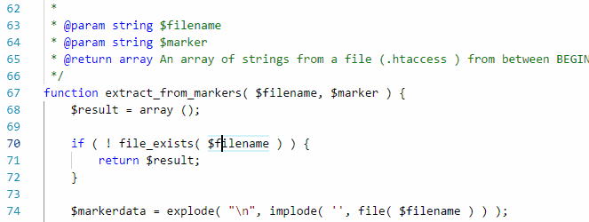

/*
Title: Refactoring
Description: 
*/

# Refactoring

Refactoring features let you make semantic-based code modifications across multiple files. Changes are applied only when PHP Tools has enough information to ensure the code won't be corrupted.

Refactoring works best on well-documented code with annotated types and type hints for function parameters and return types.

> The refactoring is disabled (aborted) when there is a syntax error in the project. This is done in order to avoid corrupting the code.

## Rename Symbol

Name of local variables, constants, functions and type names can be renamed.

Right-click the name and choose `Rename Symbol`, or select a name and press the `F2` key. Alter the name and confirm. If more than the current document is affected by the change, all documents are opened in the Visual Studio Code window so the changes can be reviewed or reverted. Changes are not saved to disk.

---

The rename works across the workspace, and takes indirect names and special annotations in consideration - this includes PHP callables using array syntax, special string literals in the context of `ReflectionClass`, `#[DataSource()]` etc., name of identifiers in various frameworks like Laravel or WordPress.

Renames can span the whole project, including files on the include path and temporary project files.

## See also

- [Code Actions](code-actions.md)
- [PHPDoc Completion](phpdoc.md)
