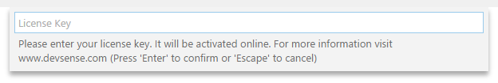
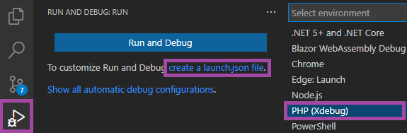
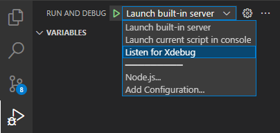

/*
Title: Getting Started
Description: PHP Tools for VS Code - Getting Started.
*/

# Getting Started

Welcome to PHP Tools for Visual Studio Code. This extension adds PHP language support to Visual Studio Code, including a full code editor, debugger, built-in server, tester, and MCP for AI agents.

## Premium Features

Premium features are enabled for our active subscribers. See [the purchase page](https://www.devsense.com/purchase) for more information.

**Activation**: Open the **Command Palette** from the **View** menu and search for the command **`PHP Tools: Activate License`**. Enter the license key into the pop-up window below and press **Enter**. Note: activation requires an Internet connection.
  

**Trial**: Try the premium features for free. Open the **Command Palette** and search for the command **`PHP Tools: Begin Free Trial ...`**.

## Opening a Folder

Open the folder that contains your PHP application to get the most out of the extension.

## Enable Debug

Create launch settings so VS Code can run and debug your PHP code. Navigate to **Run and Debug**, and create a new `launch.json` file. If prompted, select **`PHP (Xdebug)`**.

This creates default launch settings with common launch profiles:

- **`Launch built-in server`** starts the PHP development server within your opened folder, checks debugging capabilities, and starts listening for Xdebug connections.
- **`Launch current script in console`** runs and debugs the currently opened PHP document as a console PHP program.
- **`Listen for Xdebug`** starts debugging and waits for an incoming Xdebug connection.

The launch profiles and corresponding settings can be added, removed, or edited in the created `.vscode/launch.json` file.

## Configuring PHP

The vast majority of the extension's features work out of the box. The debugger and test explorer functionalities require, however, a working installation of [PHP](https://secure.php.net/) together with [Xdebug](https://xdebug.org/) extension.

See [Selecting PHP version](php-version.md) for more information.

## See Also

- [Configuration](configuration.md)
- [Selecting PHP version](php-version.md)
- [Test Explorer](test-explorer.md)
- [Debug](debug/index.md)