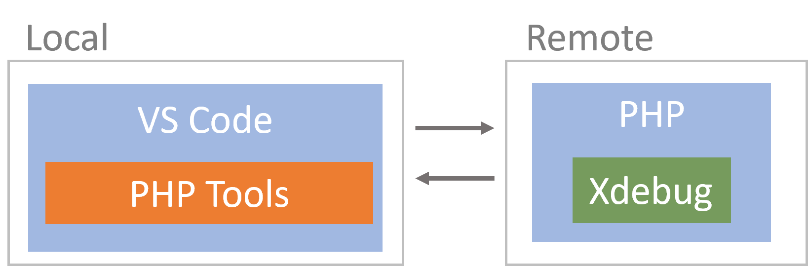
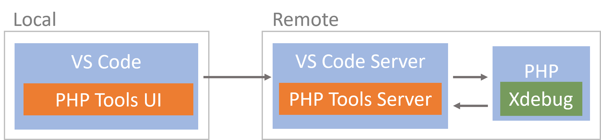

/*
Title: Remote Development
Description: Developing PHP remotely with VS Code
*/

# Remote Development

PHP Tools for VS Code can work with a remote system in two modes:

- VS Code runs fully in the local environment and communicates with PHP on a remote system.
- The VS Code client runs locally, but the VS Code server runs on a remote system.

## VS Code Runs Fully on a Local System

This is a well-known approach to having a development system on a local machine while running and debugging on a remote machine that is as close as possible to the production environment. A mechanism must be in place to keep the source code in sync between both environments.



### Configuration

1. **Xdebug configuration**

   Locate the Xdebug configuration file (`php.ini` or `xdebug.ini`). Running `php --ini` helps find it.

   Update the configuration so `xdebug.client_host` contains the IP address of your local system, and make sure it is accessible from the remote server:

   ```ini
   xdebug.client_host=LOCAL_SERVER_IP
   xdebug.client_port=9003
   ```

   If multiple developers need access to the remote server, you need a [DBGP proxy](debug/dbgp-proxy.md).

2. **Launch profile**

   Alter your `launch.json` file and add `pathMappings` so the debugger knows how to map remote paths to local paths:

   ```json
   {
       "name": "Listen for Xdebug",
       "type": "php",
       "request": "launch",
       "port": 9003,

       "pathMappings": {
           "/var/www/html": "${workspaceRoot}\\html"
       }
   }
   ```

   See [Launch Profiles](debug/launch-json.md) for more information about launch profiles and related configurations.

3. **Restart the remote server.**

   For Apache, run `sudo service apache2 restart`.

## VS Code Server Runs on a Remote System

This scenario is superior to the previous one because you work entirely remotely. No source code needs to be on your local machine, no Xdebug configuration to connect to the local system is needed, and `launch.json` does not require path mappings. In addition, you get remote testing support and the terminal of the remote machine while maintaining full IntelliSense, navigation, and refactoring capabilities.



For this to work you need the [Remote Development extension pack](https://aka.ms/vscode-remote/download/extension), which contains three extensions, each supporting a different remote scenario:

- **WSL** - full Linux experience in the Windows Subsystem for Linux
- **SSH** - connect to a remote machine through SSH
- **Container** - develop inside a Docker container

We have prepared a detailed tutorial for this scenario: [How to develop PHP inside a Docker Container using VS Code](https://blog.devsense.com/2022/develop-php-in-docker).

If you have VS Code and Docker Desktop installed, you can start quickly with this button:

<div>
<a class="btn btn-primary" href="vscode://ms-vscode-remote.remote-containers/cloneInVolume?url=https://github.com/DEVSENSE/vscode-remote-sample-php">Quick Start NOW!</a>
</div>

## Related links

- [How to develop PHP inside a Docker Container using VS Code](https://blog.devsense.com/2022/develop-php-in-docker)
- [Launch Profiles](debug/launch-json.md)
