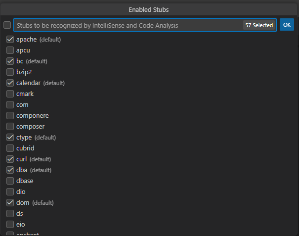
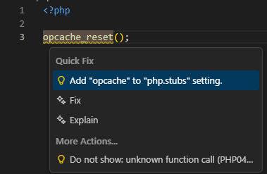

/*
Title: Stubs and Packages
Description: Including PHP extension stubs, custom stubs, and composer packages.
*/

# Workspace Stubs

Add stubs for PHP extensions and frameworks so the editor can provide complete code completion, diagnostics, and IntelliSense for symbols that your project depends on.

Stubs can be obtained in various ways. There are stubs for standard PHP extensions, stubs for well-known PHP native extensions, and stubs for whole frameworks such as WordPress.

### Command `> Workspace Stubs`

Use the **Workspace Stubs** command from the **Command Palette** (`F1`):

There you can enable or disable stubs for standard PHP extensions and a few additional stubs including WordPress, Composer, and php-amqp.

### Workspace Stubs Language

Most stubs are translated into all major languages including English, German, Spanish, French, Italian, Japanese, Russian, and Chinese. The language is set automatically based on your IDE UI language and can be overridden using the setting `"phpTools.language"`.

### Setting `"php.stubs"`

The setting `"php.stubs"` is equivalent to the **Workspace Stubs** command.

### Add Stub Code Action

Whenever a function from a stub is not yet included, you can use a code action to include the corresponding stub.

### Composer.json `ext-`

If you use Composer, `composer.json` can optionally specify required PHP extensions (see the [composer.json schema#require](https://getcomposer.org/doc/04-schema.md#require:~:text=PHP%20extensions%20your%20project%20needs)).

The editor respects the `require` and `require-dev` sections and automatically includes stubs for the extensions listed there.

### Composer Packages

Various other stubs are available as Composer packages. Add them as development requirements (`"require-dev"`) to your project using the [`composer: require-dev`](./tools/composer.md#composer-require-dev) command.

### Custom Stubs

Additional third-party stubs provided as a `.php` file with definitions can be placed anywhere inside the workspace. The editor processes the files and uses the containing definitions.

## See Also

- [Composer Integration](./tools/composer.md)
- [WordPress Stubs and Linting](https://blog.devsense.com/2023/wordpress-intellisense-linting-vscode/)
